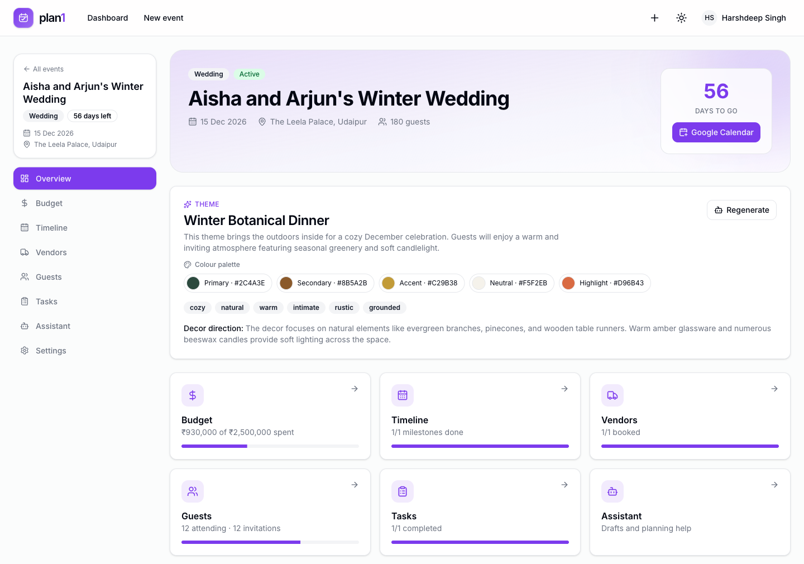
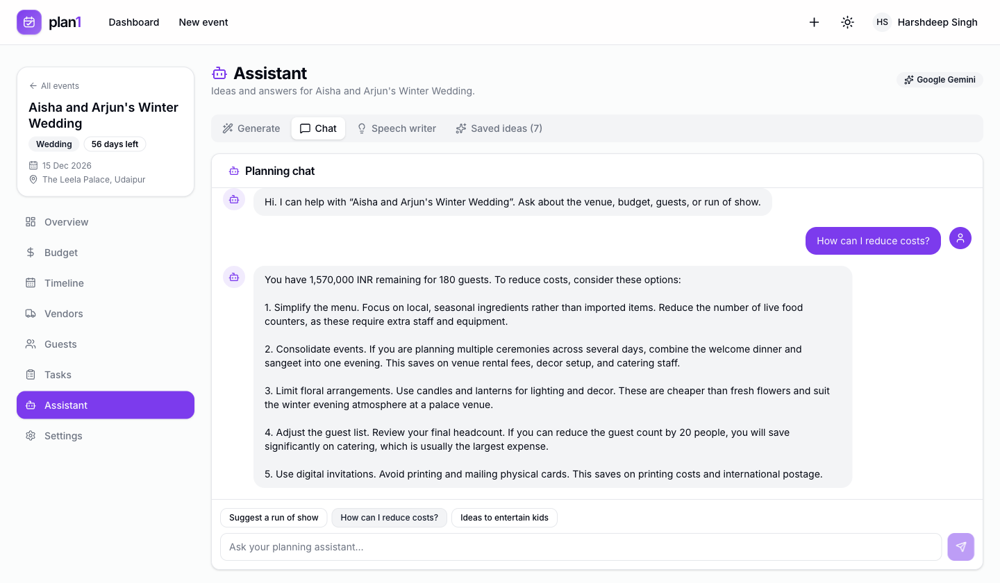
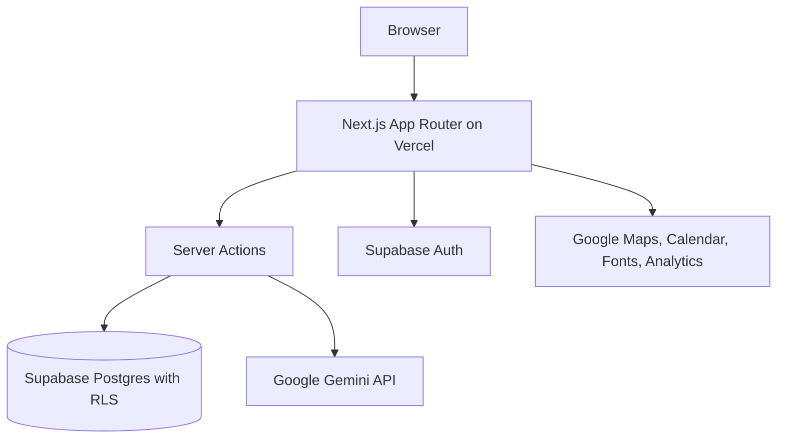

# plan1

**A GenAI event planner for weddings, birthdays, and community events.**

plan1 keeps the theme, budget, guests, vendors, tasks, and timeline in one place. Gemini writes a starting point. You edit it.

[](https://plan1-zeta.vercel.app)
[](https://github.com/harshdeepsinghin/plan1/actions/workflows/ci.yml)
[](LICENSE)
[](https://nextjs.org)
[](https://supabase.com)
[](https://ai.google.dev)

[](https://plan1-zeta.vercel.app)

| Event overview | Gemini planning chat |
| --- | --- |
|  |  |

Live: https://plan1-zeta.vercel.app  
Repo: https://github.com/harshdeepsinghin/plan1

Built for Hack2Skill Challenge 5 (Celebration & Event Planner).

## Try it

1. Open https://plan1-zeta.vercel.app.
2. Create an account with email or Google.
3. Add an event with a date, venue, guest count, and budget.
4. Gemini writes a first theme, timeline, and budget while the event is created.
5. Open the assistant tab for vendor ideas, activities, checklists, and speeches.

## The problem

Planning an event means keeping track of a lot of small decisions. The theme lives in a mood board, the budget lives in a spreadsheet, vendors live in email, and the guest list lives in a chat. plan1 puts those pieces under one event so you can see what is done and what still needs attention.

## What it does

### Planning tools

- **Theme:** a theme name, description, colour palette, mood keywords, and decor direction
- **Budget:** categories, line items, estimated cost, actual cost, and remaining budget
- **Timeline:** milestones with due dates, priorities, categories, and overdue states
- **Vendors:** a board from research to booked, with quotes, contacts, ratings, and notes
- **Guests:** CSV import and export, RSVP status, groups, plus-ones, and dietary notes
- **Tasks:** a board with due dates, priorities, assignees, and notes
- **Collaboration:** invite an existing planner as an editor or viewer
- **Preferences:** currency, timezone, date format, and default occasion
- **Exports:** guest CSV, budget CSV, timeline CSV, full plan JSON, and an `.ics` file

### Gemini tools

| Tool | Output |
| --- | --- |
| Theme | Theme name, description, palette, mood keywords, decor direction |
| Colour palette | Five colours with hex codes and usage notes |
| Budget breakdown | Suggested category amounts for the event budget |
| Timeline | Milestones from today to the event date |
| Vendor suggestions | Vendor types, search ideas, questions to ask, and red flags |
| Activities | Entertainment ideas, rituals, and things for guests to do |
| Checklist | A to-do list grouped by phase and priority |
| Speech writer | Drafts for a role and tone, ready to edit |
| Chat | Answers about the venue, budget, guests, or run of show |

### Google services

| Service | Use |
| --- | --- |
| Google Gemini | Themes, budgets, timelines, vendor ideas, activities, checklists, speeches, and chat |
| Google Sign-In | OAuth through Supabase Auth |
| Google Calendar | Add an event to Google Calendar from the overview or settings |
| Google Maps | Directions links and a lazy-loaded venue map |
| Google Fonts | Inter through `next/font/google` |
| Google Analytics 4 | Optional page analytics when `NEXT_PUBLIC_GA_MEASUREMENT_ID` is set |

## Architecture



## How it works

### Creating an event

1. The form checks the input with Zod and inserts a row in `events`.
2. Three Gemini calls run in parallel: theme, timeline, and budget.
3. The theme is stored on `events.ai_generated_theme`. Timeline rows go into `milestones`. Budget rows go into `budget_categories`. Raw output is kept in `ai_ideas`.
4. If a Gemini call fails, the event is still created. The planner can try again from the assistant.
5. The user lands on the event overview with whatever was generated.

### Prompts and context

Every generator gets the same event context: type, title, date, venue, guest count, budget, amount spent, location, cultural background, and free-text notes. The prompts are in `src/lib/gemini/prompts.ts` and return structured JSON so the UI can render the result.

All prompts also get a style instruction: write in plain English, avoid em dashes and en dashes, and skip marketing language. This keeps generated copy closer to something a person would write.

### Gemini client

`src/lib/gemini/client.ts` calls the Gemini REST API directly.

- Primary model: `gemini-3.6-flash`
- Fallback chain: `gemini-3.1-flash-lite`, `gemini-3.5-flash-lite`, `gemini-3.5-flash`
- 12 second timeout per model for JSON, 25 seconds for long text
- 45 second total budget for JSON, 80 seconds for text
- One retry on `429`, then move to the next model
- Thinking is disabled on full Flash models to reduce latency
- JSON wrapped in prose or code fences is extracted before parsing
- Rate limits and busy endpoints get a short, readable error

You can override the model chain with `GEMINI_MODEL` and `GEMINI_FALLBACK_MODELS`.

### Permissions

Supabase Row Level Security protects every table. Owners can read and write their own events. Collaborators can read an event after they accept an invite. Editors can update content. Viewers are read-only.

`SECURITY DEFINER` helpers such as `is_event_owner`, `can_access_event`, and `can_edit_event` keep the policies from calling themselves recursively. Event settings, collaborator management, and event deletion are owner-only.

Invites are matched to an existing planner account and accepted immediately. There is no email delivery service in this build, so there is no pending invite state.

### Server actions

All writes are Next.js Server Actions in `src/actions/`. Forms are validated with Zod, the action checks the current user, and affected routes are revalidated after success. No public write API is exposed.

### Preferences

Currency, timezone, date format, and default occasion are stored on `profiles`. The dashboard layout passes them to a client provider, and shared formatters handle display in the rest of the app.

Currency changes labels and future Gemini estimates. Amounts are stored as plain numbers and are not converted when the currency changes. The profile page says this next to the setting.

## Stack

| Layer | Technology |
| --- | --- |
| Frontend | Next.js 16 App Router, React 19, TypeScript |
| Styling | Tailwind CSS 4, shadcn/ui, Radix UI, lucide-react |
| Database | Supabase PostgreSQL with Row Level Security |
| Auth | Supabase Auth with email/password, Google OAuth, and email links |
| Gemini | Google Gemini API on the free AI Studio tier |
| Hosting | Vercel |
| Drag and drop | dnd-kit |
| Validation | Zod |

## Project structure

```text
src/
├── app/
│   ├── auth/                  # login, signup, callback, password reset
│   ├── (dashboard)/
│   │   ├── dashboard/         # owned and shared events
│   │   ├── events/
│   │   │   ├── new/           # create event and first draft
│   │   │   └── [id]/
│   │   │       ├── overview/
│   │   │       ├── budget/
│   │   │       ├── timeline/
│   │   │       ├── vendors/
│   │   │       ├── guests/
│   │   │       ├── tasks/
│   │   │       ├── ai-assistant/
│   │   │       └── settings/
│   │   └── profile/
│   ├── globals.css
│   └── page.tsx               # landing page
├── actions/                   # server actions
├── components/
│   ├── brand/                 # plan1 mark and wordmark
│   ├── layout/                # header and event sidebar
│   ├── navigation/            # intent-based prefetch link
│   └── ui/                    # shadcn/ui primitives
├── lib/
│   ├── auth.ts                # request-scoped user and profile
│   ├── data/                  # request-scoped event queries
│   ├── gemini/                # API client and prompts
│   ├── preferences.ts         # currency, timezone, date formats
│   ├── supabase/              # browser and server clients
│   ├── validations/           # Zod schemas
│   └── utils.ts
├── proxy.ts                   # session refresh and route gate
└── types/

supabase/
├── migrations/
└── seed.sql
```

## Run it locally

### Requirements

- Node.js 20 or newer
- A free Supabase project
- A Gemini API key from Google AI Studio
- A Vercel account for deployment

### 1. Install

```bash
git clone https://github.com/harshdeepsinghin/plan1.git
cd plan1
npm install
```

### 2. Environment variables

```bash
cp .env.example .env.local
```

```env
NEXT_PUBLIC_SUPABASE_URL=https://your-project.supabase.co
NEXT_PUBLIC_SUPABASE_ANON_KEY=your-anon-key

GOOGLE_GEMINI_API_KEY=your-gemini-api-key

NEXT_PUBLIC_APP_URL=http://localhost:3000

# Optional
# GEMINI_MODEL=gemini-3.6-flash
# GEMINI_FALLBACK_MODELS=gemini-3.1-flash-lite,gemini-3.5-flash-lite,gemini-3.5-flash
# NEXT_PUBLIC_GA_MEASUREMENT_ID=G-XXXXXXXXXX
```

### 3. Database

```bash
npx supabase link --project-ref your-project-ref
npx supabase db push
```

This applies the four migrations in order. You can also paste the files from `supabase/migrations/` into the Supabase SQL Editor.

### 4. Supabase Auth

In Authentication, open URL Configuration.

- Site URL: your deployment URL or `http://localhost:3000`
- Redirect URLs: `http://localhost:3000/auth/callback` and `https://your-app.vercel.app/auth/callback`

For Google sign-in, enable the Google provider under Authentication > Providers. Add `https://<project-ref>.supabase.co/auth/v1/callback` to the Google OAuth client's authorised redirect URIs.

### 5. Start the app

```bash
npm run dev
```

Open http://localhost:3000.

### 6. Deploy

Push to GitHub, import the repo in Vercel, add the environment variables, and deploy. Set `NEXT_PUBLIC_APP_URL` to the production URL.

## Performance

- Vercel Functions run in `bom1` (Mumbai), next to the Supabase project in `ap-south-1`
- `cache()` shares one Supabase client, one auth check, one profile query, and one event query across a request
- Event routes have loading skeletons, so a click shows a skeleton while the page loads
- Sidebar links prefetch the full route after hover or focus, not on first paint
- The client router cache keeps visited event tabs for 30 seconds
- The session proxy only runs on `/dashboard`, `/events`, and `/profile`
- Overview and settings queries use `Promise.all`
- The Google Map only loads when it scrolls into view

## Security

- Row Level Security on every user-facing table
- Session checks in pages, layouts, and server actions
- Owner, editor, and viewer checks on event mutations
- Zod validation on event and domain input
- Secrets only in environment variables; `.env*` and `client_secret_*.json` are gitignored
- The auth callback validates the `next` redirect to prevent open redirects

## Testing

```bash
npx tsc --noEmit
npm run lint
npm run build
```

The app was tested in Playwright on desktop and mobile: signup and login, event creation, budget items, timeline milestones, vendors, guests, tasks, theme and chat generation, speech drafts, preference updates, currency and date display, collaborator access, and the Google Map embed.

## Assumptions and limits

1. Currency is a display setting. Amounts are not converted when you change it. Gemini receives the selected currency for new estimates.
2. Collaboration requires an existing account. There is no email service in the free build.
3. Gemini output is a starting point. Every generated section is editable, and a failed call does not block event creation.
4. The Gemini free tier has rate limits and busy periods. The fallback chain handles the common cases, but it is not unlimited.
5. This is a hackathon project, not a multi-tenant production system.
6. The repo stays under 10 MB. `node_modules`, build output, local env files, and Playwright artifacts are ignored.
7. The project uses one branch, `main`.

## Future work

- Email invites and RSVP notifications through Supabase Edge Functions and Resend
- Live presence for collaborators
- Public read-only share links with RSVP
- PDF export for the full plan
- Photo mood boards and vendor attachments
- Two-way calendar sync

## License

MIT. See [LICENSE](LICENSE).

---

Built for Hack2Skill Challenge 5 with Next.js, Supabase, and Google Gemini.
